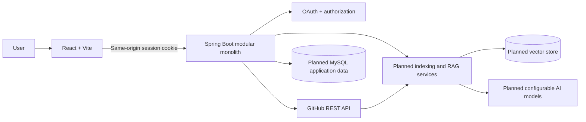

# RepoMind

RepoMind is a planned AI-powered GitHub repository assistant for exploring a codebase through grounded questions, summaries, and project-specific interview practice. The initial implementation target is a modular monolith: a React and Vite client and a Java 21/Spring Boot API backed by MySQL and a vector store.

> **Project status:** Milestone 2. GitHub OAuth sign-in, server-side sessions, current-user status, and paginated public repository listing are implemented. Indexing, chat, summaries, interview generation, and private repository access are not implemented.

## Problem statement

Understanding an unfamiliar repository requires locating relevant files, connecting code across modules, and learning how the parts work together. RepoMind will let an authorized user select a GitHub repository and branch, index eligible source files, and ask questions whose answers link back to file paths and line ranges. It will also produce repository summaries and interview questions grounded in retrieved repository context.

## Capabilities

- **Implemented:** GitHub OAuth sign-in, session-aware dashboard, current-user endpoint, and paginated public repository listing through the signed-in user's GitHub authorization.
- **Planned:** Branch selection and asynchronous indexing with visible job status and failure details.
- Source filtering, chunking, embedding, and vector search.
- Grounded Q&A, repository summaries, and interview practice with source references.
- Persistent user, repository, job, and conversation metadata in MySQL.

OAuth sessions and authorized clients are held in the backend's in-memory servlet session; user profiles and repository results are not persisted in MySQL. This milestone is single-instance until shared session storage is configured.

## Architecture

The system is a modular monolith with clear package boundaries. The frontend calls a same-origin Spring API. Spring services coordinate GitHub access, indexing, retrieval, AI provider integration, and persistence. MySQL is the source of truth for application metadata; a compatible vector store holds chunk vectors and retrieval metadata.



See [architecture](docs/ARCHITECTURE.md), [database](docs/DATABASE.md), [API](docs/API.md), [project specification](docs/PROJECT_SPEC.md), and [interview notes](docs/INTERVIEW_NOTES.md).

## Planned RAG workflow

1. The user requests indexing for an authorized repository and branch.
2. The API validates ownership/access, creates an indexing job, and fetches the selected branch tree and file contents from GitHub.
3. A policy filter excludes binary, generated, oversized, and likely secret-bearing files. Text is split into overlapping chunks while retaining path and line range.
4. An embedding provider converts chunks to vectors. The vector store records repository, branch, commit SHA, path, line range, chunk identifier, and content needed for retrieval.
5. For a question, the API checks conversation/repository authorization, embeds the query, retrieves relevant chunks within that repository/branch scope, and builds a bounded prompt.
6. The model returns a response with citations. The API validates citation identifiers against retrieved chunks and returns source paths and line ranges. If evidence is insufficient, the response should say so.

```mermaid
sequenceDiagram
  actor User
  participant API as Spring API
  participant GitHub
  participant Filter as Filter / Chunker
  participant Embed as Embedding provider
  participant VS as Vector store
  participant LLM as Chat model
  User->>API: Start index(repo, branch)
  API->>GitHub: Read tree and file content (user token)
  GitHub-->>API: Files + commit SHA
  API->>Filter: Exclude unsafe files; create line-aware chunks
  Filter->>Embed: Embed chunks
  Embed-->>Filter: Chunk vectors
  Filter->>VS: Upsert vectors + provenance metadata
  API-->>User: Job status
  User->>API: Ask question
  API->>Embed: Embed query
  Embed-->>API: Query vector
  API->>VS: Similarity search scoped to repo/branch
  VS-->>API: Ranked chunks and provenance
  API->>LLM: Question + bounded context
  LLM-->>API: Answer with chunk references
  API-->>User: Answer + verified file/line citations
```

## Authentication and security summary

GitHub login uses Spring Security's server-side OAuth authorization-code flow. The backend exchanges the code, retrieves the GitHub profile, and establishes an HTTP-only, SameSite=Lax session cookie; the authorized client remains in the backend session. The browser never receives the GitHub access token. Unsafe requests use Spring Security CSRF protection. This milestone requests `read:user` and `public_repo` and filters the repository API to public repositories. GitHub's `public_repo` OAuth scope permits full access to public repositories, including repository hooks, although RepoMind only performs reads. Private repository access is not requested. See [architecture](docs/ARCHITECTURE.md) and [API](docs/API.md).

## Planned technology

| Area | Choice |
|---|---|
| Frontend | React, Vite, JavaScript, plain CSS, React Router if needed |
| Backend | Java 21, Spring Boot, Spring Web, Spring Security, Maven |
| Authentication | GitHub OAuth 2.0 authorization code flow |
| Metadata | MySQL; schema migrations to be selected during implementation |
| AI | Spring AI abstractions with provider/model configuration externalized |
| Vector storage | Chroma or compatible Spring AI vector store; exact version/deployment to be selected |
| Packaging/deployment | Containerized frontend/API and separately managed MySQL/vector service; deployment target TBD |

## Local development on Windows

### Prerequisites

- Java 21 (the backend uses Spring Boot 3.5.16).
- Node.js 20.19.x or 22.12 and newer, plus npm (Vite 8 supports these Node.js lines).
- MySQL Server 8.x, running locally on port 3306.
- Internet access on the first build so npm and Maven can download project dependencies. The Maven Wrapper in `backend/` downloads the configured Maven distribution if it is not cached.

Local environment check: Java 21, Node.js 24, npm 11, and MySQL Server 8.0 were found; the `MySQL80` Windows service was running and port 3306 was reachable. MySQL connectivity was subsequently confirmed in Spring Boot logs. A `mvn` command was not on `PATH`; use the included wrapper (`mvnw.cmd`).

### Prepare MySQL once

Connect to your local MySQL administrator account using your own approved method. Check whether the database and application user already exist before running the additive statements below. Do not paste a real password into this repository or commit it.

```sql
CREATE DATABASE IF NOT EXISTS repomind
  CHARACTER SET utf8mb4
  COLLATE utf8mb4_0900_ai_ci;

CREATE USER IF NOT EXISTS 'repomind_app'@'localhost'
  IDENTIFIED BY 'replace-with-a-unique-local-password';

GRANT ALL PRIVILEGES ON repomind.* TO 'repomind_app'@'localhost';
```

If the user already exists, verify its password and permissions rather than replacing it blindly. These statements are documentation only; RepoMind has not run them. JPA schema generation is disabled (`ddl-auto: none`), so the app will not create or alter tables in this milestone.

### Set database variables in PowerShell

Copy `.env.example` as a reference if useful, but Spring Boot does not automatically load `.env` files. For a development session, set the variables in the same PowerShell window that will run the backend:

```powershell
$env:DB_URL = 'jdbc:mysql://localhost:3306/repomind?useSSL=false&allowPublicKeyRetrieval=true&serverTimezone=UTC'
$env:DB_USERNAME = 'repomind_app'
$securePassword = Read-Host 'Enter the local repomind_app password' -AsSecureString
$env:DB_PASSWORD = [System.Net.NetworkCredential]::new('', $securePassword).Password
```

For persistence across sessions, use **Edit environment variables for your account** in Windows, add `DB_URL`, `DB_USERNAME`, and `DB_PASSWORD`, then open a new terminal. Keep real credentials in your local environment only; `.env` files are ignored by Git.

### Register the local GitHub OAuth app

Create a GitHub OAuth App in GitHub Developer settings with homepage URL `http://localhost:5173` and authorization callback URL `http://localhost:5173/login/oauth2/code/github`. Spring Security's default callback path is `/login/oauth2/code/{registrationId}` with registration ID `github`; Vite forwards it to port 8080. Keep the OAuth client ID and secret in the local process environment only.

```powershell
$env:GITHUB_CLIENT_ID = 'your-local-oauth-client-id'
$secureOAuthSecret = Read-Host 'Enter the GitHub OAuth client secret' -AsSecureString
$env:GITHUB_CLIENT_SECRET = [System.Net.NetworkCredential]::new('', $secureOAuthSecret).Password
$env:GITHUB_REDIRECT_URI = 'http://localhost:5173/login/oauth2/code/github'
$env:FRONTEND_URL = 'http://localhost:5173'
$env:SESSION_COOKIE_SECURE = 'false'
```

Keep these variables in the same PowerShell session used to start the backend. `SESSION_COOKIE_SECURE=false` is for local HTTP development only; set it to `true` behind HTTPS in deployment. Use `localhost` consistently for the frontend and OAuth callback, rather than mixing it with `127.0.0.1`.

### Run the backend

From `backend/`, after the database and environment variables are configured:

```powershell
.\mvnw.cmd spring-boot:run
```

The API listens at `http://localhost:8080`. Check `http://localhost:8080/api/health` for `{"status":"ok","service":"repomind-api"}`. This endpoint confirms the API process is responding; it does not prove MySQL connectivity. Actuator health is available at `http://localhost:8080/actuator/health`.

### Run the frontend

From `client/` in another PowerShell window:

```powershell
npm ci
npm run dev
```

Vite prints the local URL, normally `http://localhost:5173`. Requests beginning with `/api`, `/oauth2`, and `/login/oauth2` are proxied to Spring Boot at port 8080. The callback URI registered in the GitHub OAuth App must exactly match `GITHUB_REDIRECT_URI`. After authorization, the dashboard reloads the session and public repositories. The CSRF token used for logout stays in page memory; neither it nor the GitHub access token is written to localStorage.

The Vite proxy target defaults to `http://localhost:8080`. `REPOMIND_API_ORIGIN` can override it for local testing; it is a Vite server setting and is not exposed to the browser.

### Build checks

```powershell
# In client/
npm run build

# In backend/
.\mvnw.cmd test
```

These commands verify the frontend bundle and backend tests. They do not verify a database connection unless the local database, schema, account, and environment variables have been configured.

## Documentation and milestones

This project is being developed in small milestones. Each milestone should update relevant documentation, include focused tests, and be committed separately after review. See [interview notes](docs/INTERVIEW_NOTES.md) for the intended explanation topics and known design decisions.

## License

No license has been selected yet. Add one before distributing or accepting contributions.
