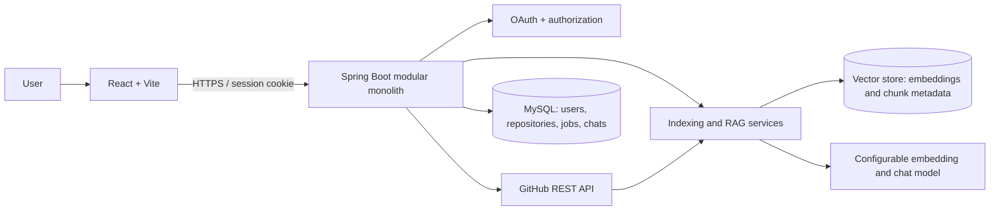

# RepoMind

RepoMind is a planned AI-powered GitHub repository assistant for exploring a codebase through grounded questions, summaries, and project-specific interview practice. The initial implementation target is a modular monolith: a React and Vite client and a Java 21/Spring Boot API backed by MySQL and a vector store.

> **Project status:** Documentation and design stage. Application behavior described below is planned and has not been implemented or tested yet.

## Problem statement

Understanding an unfamiliar repository requires locating relevant files, connecting code across modules, and learning how the parts work together. RepoMind will let an authorized user select a GitHub repository and branch, index eligible source files, and ask questions whose answers link back to file paths and line ranges. It will also produce repository summaries and interview questions grounded in retrieved repository context.

## Planned capabilities

- GitHub sign-in and repository listing limited to the signed-in user's access.
- Branch selection and asynchronous indexing with visible job status and failure details.
- Source filtering, chunking, embedding, and vector search.
- Grounded Q&A, repository summaries, and interview practice with source references.
- Persistent user, repository, job, and conversation metadata in MySQL.

## Architecture

The system is a modular monolith with clear package boundaries. The frontend calls a same-origin Spring API. Spring services coordinate GitHub access, indexing, retrieval, AI provider integration, and persistence. MySQL is the source of truth for application metadata; a compatible vector store holds chunk vectors and retrieval metadata.



See [architecture](docs/ARCHITECTURE.md), [database](docs/DATABASE.md), [API](docs/API.md), [project specification](docs/PROJECT_SPEC.md), and [interview notes](docs/INTERVIEW_NOTES.md).

## RAG workflow

1. The user requests indexing for an authorized repository and branch.
2. The API validates ownership/access, creates an indexing job, and fetches the selected branch tree and file contents from GitHub.
3. A policy filter excludes binary, generated, oversized, and likely secret-bearing files. Text is split into overlapping chunks while retaining path and line range.
4. An embedding provider converts chunks to vectors. The vector store records repository, branch, commit SHA, path, line range, chunk identifier, and content needed for retrieval.
5. For a question, the API checks conversation/repository authorization, embeds the query, retrieves relevant chunks within that repository/branch scope, and builds a bounded prompt.
6. The model returns a response with citations. The API validates citation identifiers against retrieved chunks and returns source paths and line ranges. If evidence is insufficient, the response should say so.

```mermaid
sequenceDiagram
  actor User
  participant API as Spring API
  participant GitHub
  participant Filter as Filter / Chunker
  participant Embed as Embedding provider
  participant VS as Vector store
  participant LLM as Chat model
  User->>API: Start index(repo, branch)
  API->>GitHub: Read tree and file content (user token)
  GitHub-->>API: Files + commit SHA
  API->>Filter: Exclude unsafe files; create line-aware chunks
  Filter->>Embed: Embed chunks
  Embed-->>Filter: Chunk vectors
  Filter->>VS: Upsert vectors + provenance metadata
  API-->>User: Job status
  User->>API: Ask question
  API->>Embed: Embed query
  Embed-->>API: Query vector
  API->>VS: Similarity search scoped to repo/branch
  VS-->>API: Ranked chunks and provenance
  API->>LLM: Question + bounded context
  LLM-->>API: Answer with chunk references
  API-->>User: Answer + verified file/line citations
```

## Authentication and security summary

The planned login uses GitHub's server-side OAuth authorization-code flow. The backend owns the client secret, exchanges the code, retrieves the GitHub identity, and establishes an HTTP-only, Secure, SameSite session cookie. OAuth state is validated to prevent request forgery. The browser never receives the GitHub access token or model API key. Repository and conversation access is checked against the authenticated local user on every request. See the security sections in the architecture and API documents.

## Planned technology

| Area | Choice |
|---|---|
| Frontend | React, Vite, JavaScript, plain CSS, React Router if needed |
| Backend | Java 21, Spring Boot, Spring Web, Spring Security, Maven |
| Authentication | GitHub OAuth 2.0 authorization code flow |
| Metadata | MySQL; schema migrations to be selected during implementation |
| AI | Spring AI abstractions with provider/model configuration externalized |
| Vector storage | Chroma or compatible Spring AI vector store; exact version/deployment to be selected |
| Packaging/deployment | Containerized frontend/API and separately managed MySQL/vector service; deployment target TBD |

## Local setup and configuration

There is no runnable application yet. Before implementation, configure GitHub OAuth callback URLs, database credentials, model provider credentials, and vector-store connectivity through environment variables or a secret manager. Keep `.env` files and all credentials out of Git. A future `.env.example` may contain names and safe placeholders only.

## Documentation and milestones

This project is being developed in small milestones. Each milestone should update relevant documentation, include focused tests, and be committed separately after review. See [interview notes](docs/INTERVIEW_NOTES.md) for the intended explanation topics and known design decisions.

## License

No license has been selected yet. Add one before distributing or accepting contributions.
