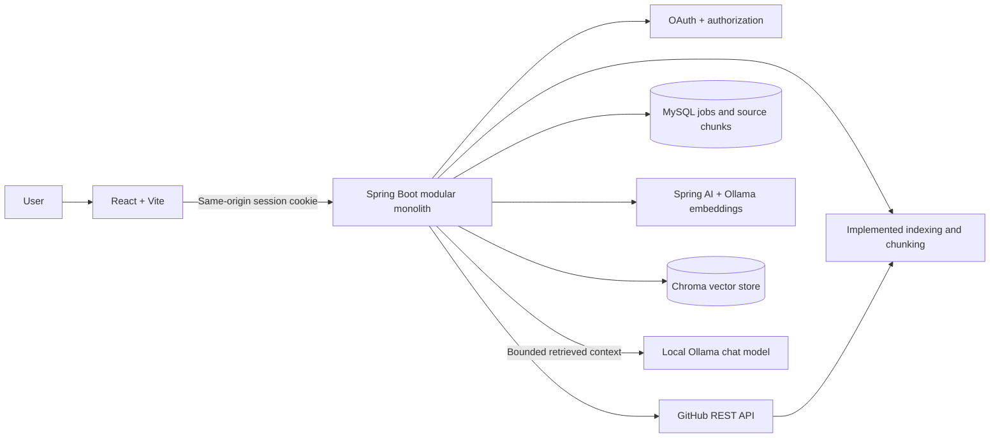

# RepoMind

RepoMind is an AI-powered GitHub repository assistant in development. It is a modular monolith with a React/Vite client and a Java 21/Spring Boot API backed by MySQL.

> **Project status:** Repository Q&A now reuses the implemented GitHub OAuth, public repository browsing, indexing, MySQL chunks, Ollama embeddings, and Chroma semantic retrieval. Q&A generation requires a locally installed Ollama chat model configured with `REPOMIND_CHAT_MODEL`. Summaries, interview generation, and private repository access remain unimplemented.

## Problem statement

Understanding an unfamiliar repository requires locating relevant files, connecting code across modules, and learning how the parts work together. RepoMind will let an authorized user select a GitHub repository and branch, index eligible source files, and ask questions whose answers link back to file paths and line ranges. It will also produce repository summaries and interview questions grounded in retrieved repository context.

## Capabilities

- **Implemented:** GitHub OAuth sign-in, session-aware dashboard, current-user endpoint, paginated public repository listing, and branch selection.
- **Implemented:** Bounded asynchronous indexing jobs for public repositories, source-file filtering, overlapping line-aware chunking, job status, and chunk persistence in MySQL.
- **Implemented:** Owner-scoped saved index status, including the latest attempt and most recent successful snapshot, so the dashboard retains status after reload and identifies when indexing is needed.
- **Implemented:** Spring AI embeddings through local Ollama and semantic retrieval through Chroma. Existing chunks are embedded lazily on the first search for a repository's latest completed snapshot. Results include filtered source snippets, file paths, line ranges, scores, and commit SHA.
- **Implemented:** Search embeddings include each file's path, language, and detected Java declarations. Retrieval merges an owner/repository/commit-filtered Chroma candidate set with bounded MySQL lexical candidates and reranks by semantic relevance, source terms, and file/symbol matches. This helps implementation questions find code when relevant chunks are present.
- **Implemented:** Repository Q&A retrieves the authenticated user's latest completed snapshot, generates a local Ollama answer from a bounded context, and returns citations mapped to verified source paths and line ranges. Answers without valid supporting source IDs abstain.
- **Planned:** Repository summaries and interview practice with source references.
- OAuth profiles, repository cards, conversations, and GitHub credentials are not persisted in MySQL; index jobs and source chunks are.

OAuth sessions and authorized clients are held in the backend's in-memory servlet session; user profiles and repository results are not persisted in MySQL. Index jobs and eligible source chunks are stored in MySQL. This milestone is single-instance until shared session storage and coordinated job scheduling are configured.

## Architecture

The system is a modular monolith with clear package boundaries. The frontend calls a same-origin Spring API. Spring services coordinate GitHub access, indexing, retrieval, AI provider integration, and persistence. MySQL is the source of truth for application metadata; a compatible vector store holds chunk vectors and retrieval metadata.




See [architecture](docs/ARCHITECTURE.md), [database](docs/DATABASE.md), [API](docs/API.md), [project specification](docs/PROJECT_SPEC.md), and [interview notes](docs/INTERVIEW_NOTES.md).

## Implemented indexing and semantic retrieval workflow

1. The authenticated user requests a branch page or starts indexing with the GitHub repository ID and branch. The server confirms the repository appears in that user's GitHub-visible public repository list and resolves the branch to a commit SHA.
2. A bounded worker loads the recursive commit tree and public blob contents. Truncated trees are rejected; generated, binary, symlink, submodule, oversized, and likely secret-bearing files are skipped. Configured file, byte, tree, duration, worker, and queue limits bound the work.
3. The chunker produces bounded overlapping text chunks with 1-based line ranges and repository/user/branch/commit/path/blob metadata. Chunks are persisted to MySQL only when the complete job succeeds. Failure returns a safe code; chunks are never returned by job APIs.
  4. On a semantic-search request, the backend selects the authenticated user's latest completed snapshot. Pending or prior-format MySQL chunks are sent in bounded batches to Spring AI's Ollama embedding integration and Chroma. Each embedding document includes path, language, and detected Java declarations alongside the source chunk. Stable chunk IDs make re-embedding an upsert; completed batches are marked in MySQL.
  5. The backend embeds the retrieval query through the same configured embedding model and asks Chroma for an oversampled candidate set using owner, repository, and commit filters. It combines those candidates with bounded MySQL lexical matches, reranks by semantic similarity plus content/path matches (including filename and symbol matches), then checks relational ownership and commit metadata again.
  6. Repository Q&A reuses those results, caps the context at 12,000 characters, labels each source with an application-generated ID, and sends the question and snippets only to the configured local Ollama chat model. Repository text is untrusted input. The model returns answer text and source IDs; the server discards unknown IDs and creates citations from the retrieved MySQL metadata. No evidence or invalid citations yield an explicit abstention.


sequenceDiagram
  participant User
  participant API as Spring API
  participant Embed as Embedding provider
  participant VS as Vector store
  participant Ollama as Local Ollama chat model
  User->>API: POST /api/repositories/{id}/ask
  API->>Embed: Embed query and any pending chunks
  Embed-->>API: Query/chunk vectors
  API->>VS: Search with owner/repo/commit filters
  VS-->>API: Candidate IDs and scores
  API->>API: Verify candidates through owned MySQL snapshot
  API->>Ollama: Question + bounded retrieved snippets
  Ollama-->>API: Answer + source IDs
  API->>API: Validate IDs; map citations from MySQL metadata
  API-->>User: Answer + cited snippets
```

## Authentication and security summary

GitHub login uses Spring Security's server-side OAuth authorization-code flow. The backend exchanges the code, retrieves the GitHub profile, and establishes an HTTP-only, SameSite=Lax session cookie; the authorized client remains in the backend session. The browser never receives the GitHub access token. Unsafe requests use Spring Security CSRF protection. This milestone requests `read:user` and `public_repo` and limits repository browsing/indexing to public repositories. GitHub's `public_repo` OAuth scope permits full access to public repositories, including repository hooks, while RepoMind only makes read requests for metadata and source content. Private repository access is not requested. See [architecture](docs/ARCHITECTURE.md) and [API](docs/API.md).

## Planned technology

| Area | Choice |
|---|---|
| Frontend | React, Vite, JavaScript, plain CSS, React Router if needed |
| Backend | Java 21, Spring Boot, Spring Web, Spring Security, Maven |
| Authentication | GitHub OAuth 2.0 authorization code flow |
| Metadata and indexed chunks | MySQL with Flyway versioned migrations |
| AI | Spring AI 1.1.x (Spring Boot 3.5 compatible) with local Ollama `nomic-embed-text` embeddings |
| Vector storage | Chroma through the Spring AI VectorStore API |
| Packaging/deployment | Containerized frontend/API and separately managed MySQL/vector service; deployment target TBD |

## Local development on Windows

### Prerequisites

- Java 21 (the backend uses Spring Boot 3.5.16).
- Node.js 20.19.x or 22.12 and newer, plus npm (Vite 8 supports these Node.js lines).
- MySQL Server 8.x, running locally on port 3306.
- Internet access on the first build so npm and Maven can download project dependencies. The Maven Wrapper in `backend/` downloads the configured Maven distribution if it is not cached.

Local environment check: Java 21, Node.js 24, npm 11, and MySQL Server 8.0 were found; the `MySQL80` Windows service was running and port 3306 was reachable. MySQL connectivity was subsequently confirmed in Spring Boot logs. A `mvn` command was not on `PATH`; use the included wrapper (`mvnw.cmd`).

### Prepare MySQL once

Check the Windows service and start it from an elevated PowerShell window if it is stopped:

```powershell
Get-Service MySQL80
Start-Service MySQL80
```

If the service has another name on your machine, find it with `Get-Service *mysql*` and use that service name.

Connect to your local MySQL administrator account using your own approved method. Check whether the database and application user already exist before running the additive statements below. Do not paste a real password into this repository or commit it.

```sql
CREATE DATABASE IF NOT EXISTS repomind
  CHARACTER SET utf8mb4
  COLLATE utf8mb4_0900_ai_ci;

CREATE USER IF NOT EXISTS 'repomind_app'@'localhost'
  IDENTIFIED BY 'replace-with-a-unique-local-password';

GRANT ALL PRIVILEGES ON repomind.* TO 'repomind_app'@'localhost';
```

If the user already exists, verify its password and permissions rather than replacing it blindly. These statements are documentation only; RepoMind has not run them. Hibernate schema generation is disabled (`ddl-auto: none`); Flyway applies versioned migrations for the indexing tables during backend startup.

### Set database variables in PowerShell

Copy `.env.example` as a reference if useful, but Spring Boot does not automatically load `.env` files. For a development session, set the variables in the same PowerShell window that will run the backend:

```powershell
$env:DB_URL = 'jdbc:mysql://localhost:3306/repomind?useSSL=false&allowPublicKeyRetrieval=true&serverTimezone=UTC'
$env:DB_USERNAME = 'repomind_app'
$securePassword = Read-Host 'Enter the local repomind_app password' -AsSecureString
$env:DB_PASSWORD = [System.Net.NetworkCredential]::new('', $securePassword).Password
```

For persistence across sessions, use **Edit environment variables for your account** in Windows, add `DB_URL`, `DB_USERNAME`, and `DB_PASSWORD`, then open a new terminal. Keep real credentials in your local environment only; `.env` files are ignored by Git.

### Register the local GitHub OAuth app

Create a GitHub OAuth App in GitHub Developer settings with homepage URL `http://localhost:5173` and authorization callback URL `http://localhost:5173/login/oauth2/code/github`. Spring Security's default callback path is `/login/oauth2/code/{registrationId}` with registration ID `github`; Vite forwards it to port 8080. Keep the OAuth client ID and secret in the local process environment only.

```powershell
$env:GITHUB_CLIENT_ID = 'your-local-oauth-client-id'
$secureOAuthSecret = Read-Host 'Enter the GitHub OAuth client secret' -AsSecureString
$env:GITHUB_CLIENT_SECRET = [System.Net.NetworkCredential]::new('', $secureOAuthSecret).Password
$env:GITHUB_REDIRECT_URI = 'http://localhost:5173/login/oauth2/code/github'
$env:FRONTEND_URL = 'http://localhost:5173'
$env:SESSION_COOKIE_SECURE = 'false'
```

Keep these variables in the same PowerShell session used to start the backend. `SESSION_COOKIE_SECURE=false` is for local HTTP development only; set it to `true` behind HTTPS in deployment. Use `localhost` consistently for the frontend and OAuth callback, rather than mixing it with `127.0.0.1`.

### Run the backend

From `backend/`, after the database and environment variables are configured:

```powershell
.\mvnw.cmd spring-boot:run
```

The API listens at `http://localhost:8080`. Check `http://localhost:8080/api/health` for `{"status":"ok","service":"repomind-api"}`. This endpoint confirms the API process is responding; it does not prove MySQL connectivity. Actuator health is available at `http://localhost:8080/actuator/health`.

### Run the frontend

From `client/` in another PowerShell window:

```powershell
npm ci
npm run dev
```

Vite prints the local URL, normally `http://localhost:5173`. Requests beginning with `/api`, `/oauth2`, and `/login/oauth2` are proxied to Spring Boot at port 8080. The callback URI registered in the GitHub OAuth App must exactly match `GITHUB_REDIRECT_URI`. After authorization, the dashboard reloads the session and public repositories. The CSRF token used for logout stays in page memory; neither it nor the GitHub access token is written to localStorage.

The Vite proxy target defaults to `http://localhost:8080`. `REPOMIND_API_ORIGIN` can override it for local testing; it is a Vite server setting and is not exposed to the browser.

### Local semantic-search services

Semantic retrieval uses local inference and vector storage. Install [Ollama for Windows](https://ollama.com/download/windows), start its local service, and download the embedding model once:

```powershell
ollama pull nomic-embed-text
```

The Ollama desktop app normally starts its service on Windows. If it is not running, start it in a separate terminal with `ollama serve`. RepoMind accepts only loopback Ollama and Chroma endpoints because both services receive repository source text.

Start Chroma in Docker with persistent local storage (Docker Desktop must be running). For a new container:

```powershell
docker run -d --name repomind-chroma -p 8000:8000 -v repomind_chroma:/data ghcr.io/chroma-core/chroma:1.0.0
```

After a Windows or Docker restart, use `docker start repomind-chroma` for the existing container.

The backend defaults to Ollama at `http://localhost:11434` and Chroma at `http://localhost:8000`; configure `OLLAMA_BASE_URL`, `CHROMA_HOST`, and `CHROMA_PORT` to override them. `REPOMIND_EMBEDDING_MODEL` selects the Ollama model, and `REPOMIND_EMBEDDING_BATCH_SIZE` controls pending chunks per vector write (1–128). Use the same embedding model for chunks and questions. Changing model names causes the selected snapshot's chunks to be embedded again from MySQL. If vector dimensions change, point `REPOMIND_CHROMA_COLLECTION` at a new collection before searching; Chroma requires a collection to use a consistent dimension. No paid AI API key is required. Keep both services running before starting Spring Boot; Spring AI initializes the Chroma collection during startup.

Repository Q&A additionally needs a local Ollama **chat** model. The currently configured `nomic-embed-text` model is for embeddings and cannot generate answers. Select a chat-capable model suitable for your computer, install its tag with `ollama pull <model-tag>`, then set this in the backend PowerShell session before starting Spring Boot:

```powershell
$env:REPOMIND_CHAT_MODEL = "<installed-model-tag>"
```

For example, use the exact tag shown by `ollama list`; do not set the embedding-only model here. With the variable unset or a chat model unavailable, the ask endpoint returns a safe `503` and code `LOCAL_CHAT_MODEL_NOT_CONFIGURED` or `LOCAL_CHAT_MODEL_UNAVAILABLE`. On Windows, install the selected chat tag with `ollama pull <model-tag>` before setting `REPOMIND_CHAT_MODEL`. Both Ollama embedding/chat and Chroma endpoints are restricted to loopback because they receive repository source text; Spring Boot fails fast if either base URL is remote. Semantic code search and the rest of the backend remain usable when the local services are running.

The dashboard loads saved index state through `GET /api/repositories/{repositoryId}/index-status`. It reports the newest job attempt and the latest successful snapshot separately; after a re-index failure, the earlier completed snapshot remains available to Q&A. Each answer labels the repository, branch, and commit used.

### Indexing configuration

The defaults are safe local-development limits; override them only in the backend process environment. Values are validated and capped by the application.

| Variable | Default | Purpose |
|---|---:|---|
| `INDEX_MAX_FILES` | `500` | Maximum eligible files per job |
| `INDEX_MAX_FILE_BYTES` | `262144` | Maximum bytes in one source file |
| `INDEX_MAX_TOTAL_BYTES` | `10485760` | Maximum eligible content bytes in one job |
| `INDEX_MAX_TREE_ENTRIES` | `100000` | Maximum Git tree entries accepted |
| `INDEX_MAX_ACCESS_CHECK_PAGES` | `20` | Repository authorization scan cap (100 repositories per page) |
| `INDEX_CHUNK_CHARS` / `INDEX_CHUNK_OVERLAP_CHARS` | `1600` / `200` | Chunk size and overlap in characters |
| `INDEX_MAX_ACTIVE_JOBS_PER_USER` | `2` | Active user jobs per application instance |
| `INDEX_MAX_DURATION_SECONDS` | `600` | Job processing deadline |
| `INDEX_WORKER_CORE_POOL_SIZE` / `INDEX_WORKER_MAX_POOL_SIZE` | `1` / `2` | Bounded worker threads |
| `INDEX_WORKER_QUEUE_CAPACITY` | `4` | Bounded pending worker queue |

Flyway applies versioned MySQL migrations at backend startup. Interrupted `QUEUED` and `RUNNING` jobs are marked `FAILED` with `SERVER_RESTARTED` on the next startup; they are not resumed. A retry starts a new job.

Migration V2 adds per-chunk embedding status and model bookkeeping. Existing chunks are retained; their embeddings are generated the first time semantic search is requested for that repository's latest completed snapshot. Successful batches are marked in MySQL, and stable vector IDs allow a retry after a partial failure. Chroma uses a persistent Docker volume and is separate from MySQL backups.

### Build checks

```powershell
# In client/
npm run build

# In backend/
.\mvnw.cmd test
```

These commands verify the frontend bundle and backend tests. They do not verify a database connection unless the local database, schema, account, and environment variables have been configured.

## Documentation and milestones

This project is being developed in small milestones. Each milestone should update relevant documentation, include focused tests, and be committed separately after review. See [interview notes](docs/INTERVIEW_NOTES.md) for the intended explanation topics and known design decisions.

## License

No license has been selected yet. Add one before distributing or accepting contributions.
