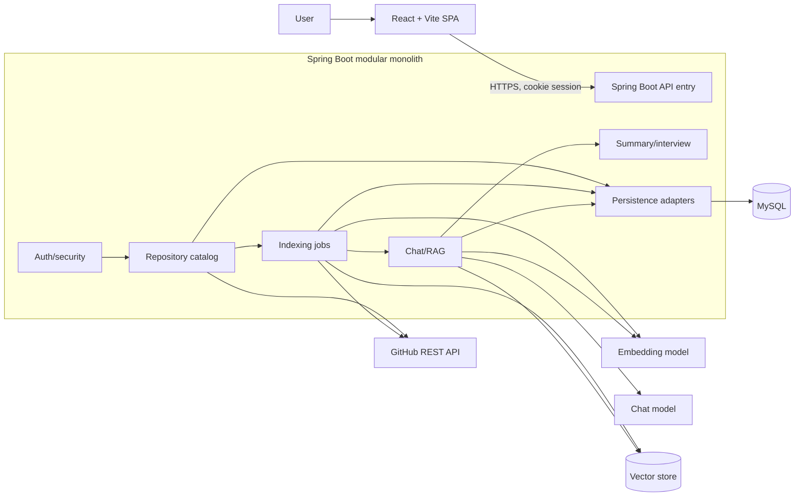

# Architecture

**Status:** Architecture baseline; later integrations and production details remain to be validated.

The Milestone 1 implementation is a responsive React/Vite client and a Spring Boot API skeleton with environment-based MySQL settings and `GET /api/health`. GitHub access, Spring Security configuration, indexing, vector storage, and model integration remain unimplemented.

## System shape

RepoMind uses one deployable Spring Boot modular monolith with internal feature modules. The React/Vite application is a separate frontend build served behind the same public origin where practical. The API coordinates GitHub, MySQL, a vector database, and configurable Spring AI model clients. MySQL owns durable application state; the vector store is a derived index that can be rebuilt from GitHub snapshots.



## Backend package boundaries

Suggested root package: `com.repomind`.

```text
auth/          controllers, OAuth callbacks, identity/session services
repository/    repository and branch DTOs, catalog service, ownership checks
indexing/      job API, orchestration, GitHub file source, filters, chunker
chat/          conversation/message APIs, retrieval, prompt and citation handling
summary/       summary and interview use cases (may start inside chat module)
integration/   GitHub, Spring AI, vector-store adapters and typed client errors
persistence/   JPA entities/repositories and database migrations
config/        security, CORS/CSRF, AI/vector configuration, async limits
common/        error response, validation, correlation ID; avoid a dumping ground
```

Controllers translate HTTP to service calls and DTOs; services own use cases and authorization; repositories handle relational persistence; integration adapters isolate external APIs. Avoid controllers calling each other or exposing persistence entities as API contracts. Keep module dependencies directed toward domain/use-case code and ports.

## Authentication and request security

1. Browser navigates to backend `/api/auth/github`.
2. Backend generates and stores one-time OAuth `state`, then redirects to GitHub authorization.
3. GitHub redirects to `/api/auth/github/callback` with code and state.
4. Backend validates state, exchanges code using a server-only client secret, obtains the GitHub user profile, and creates/updates the local user.
5. Backend creates a server session and sends only an opaque session cookie (`HttpOnly`, `Secure` in production, `SameSite=Lax` or stricter as compatible). OAuth token stays server-side.
6. Logout invalidates the local session. Revocation/deletion behavior for stored GitHub credentials must be defined.

Because sessions use cookies, unsafe methods require CSRF protection and the frontend must obtain/use the configured CSRF token. CORS should allow only known frontend origins; production should prefer a same-origin deployment. Do not use wildcard credentialed CORS. Return `401` when no session is present. Derive user identity from the Spring Security principal; never accept user ownership from request payloads.

GitHub OAuth App supports identity and user-authorized API access but typically requires broader scopes for private repository content. A GitHub App can provide finer repository permissions and short-lived tokens. The product requirement names OAuth 2.0; decide the app type before registering credentials. Request minimal scopes; never place client secrets or access tokens in Vite variables, browser storage, URLs, or logs.

## Repository authorization

The repository catalog is sourced from the authenticated GitHub API rather than trusting a client-supplied owner/name. Local rows map the GitHub repository ID to the user who connected it. Every job, conversation, and retrieval request must check current-user ownership and repository relationship. For private repositories, verify that the stored authorization remains valid and handle revocation/permission loss. Repository identifiers in a vector filter are additional isolation, not a substitute for API authorization.

## Indexing pipeline


sequenceDiagram
  participant C as Controller
  participant S as Index service
  participant G as GitHub adapter
  participant P as File policy/chunker
  participant E as Embedding adapter
  participant V as Vector store
  participant D as MySQL repositories
  C->>S: requestIndex(repoId, branch)
  S->>G: verify access + resolve branch SHA
  S->>D: persist QUEUED job
  S-->>C: job ID
  S->>D: transition RUNNING
  S->>G: fetch tree and eligible file contents
  G-->>P: path, text, commit SHA
  P->>P: reject binaries/generated/secrets; chunk with line spans
  P->>E: chunk batch
  E->>V: upsert vectors + provenance
  S->>D: persist counts and terminal status
```

Resolve a branch to an immutable commit SHA at job start. Keep per-file and total-repository limits, timeouts, bounded worker concurrency, cancellation, and retry rules. Store enough metadata to identify an index snapshot. Writes should be idempotent by a deterministic key such as repository + commit SHA + path + chunk ordinal/content hash. Treat a failed new index as incomplete; activate it only after all required work succeeds. Exact cleanup/atomic swap depends on vector-store capabilities and is an implementation decision.

## File policy and provenance

Use an allow-list of text-like extensions plus explicit language detection where possible. Exclude common build output, dependency/vendor, generated, cache, and binary paths; impose file-size, content-size, and total-index limits. Exclude sensitive filenames and apply a secret-pattern scanner before embedding. Never assume filtering catches every credential. Preserve stable 1-based line start/end through normalization and chunking. Each vector carries `userId`, `repositoryId`, `branch`, `commitSha`, `path`, `lineStart`, `lineEnd`, `chunkId`, `language`, and `jobId` metadata; do not put access tokens in metadata.

## RAG and citation integrity

At question time: authorize local repository and conversation; choose the active indexed snapshot; embed the query; perform similarity search constrained by repository and snapshot; cap context; prompt with untrusted snippets as data; request citation chunk IDs; validate those IDs against retrieved results; map them to file path and line span. Persist the user and assistant messages, citations, and model/provider metadata suitable for audit without persisting secrets. If no evidence is relevant, answer with an explicit limitation. Never let the model invent a path or line number as a citation. The first version needs neither reranking nor model tool-calling.

Summary and interview generation reuse the retrieval service with task-specific prompts and budgets. Output format is validated before returning. A provider abstraction/configuration should allow changing the chat and embedding provider without changing domain services; vector dimensions must match the configured embedding model and require reindexing when they change.

## Data and resilience

MySQL stores local users, linked GitHub identity/credential reference, repository metadata, index jobs, conversations, messages, and citation records (see [DATABASE.md](DATABASE.md)). Vector records are rebuildable derived data. Use migrations, transactions for relational state transitions, timeouts and bounded retries for external calls, and a consistent error mapper. Do not hold a database transaction open during a long GitHub or model call. Use a bounded task executor initially; a message broker is not required for the first modular-monolith version.

## Deployment plan (proposed)

- Build static Vite assets and serve behind a TLS reverse proxy/CDN; route `/api` to Spring Boot. Same-origin session cookie simplifies CSRF/CORS.
- Run one or more identical API instances only after session storage is shared (e.g. distributed Spring Session) or routing is sticky; initial deployment can use one API instance.
- Provision managed MySQL and a private vector service (Chroma or compatible) with persistent storage, network restrictions, backups, health checks, and access credentials in a secrets manager.
- Configure GitHub OAuth callback URL, allowed frontend origin, model provider/model IDs, database URL, vector endpoint, quotas, and timeouts through environment/secret management.
- Use health/readiness checks that distinguish application readiness from external provider health. Avoid returning secret/config values from diagnostics.
- Add structured logs with request/job correlation IDs, metrics for job durations/failures, provider latency/rate limits, and retrieval counts. Redact tokens and avoid raw repository source/prompt logging.
- Define retention, user data deletion, vector cleanup, database backup/restore, and incident procedures before production.

## Key decisions to validate

Boot/Spring AI compatible versions, provider and embedding dimensions, OAuth App vs GitHub App, token encryption/storage strategy, vector-store version and atomic replacement behavior, migrations tool, asynchronous worker limits, deployment provider, and data retention are intentionally unresolved until implementation planning.
