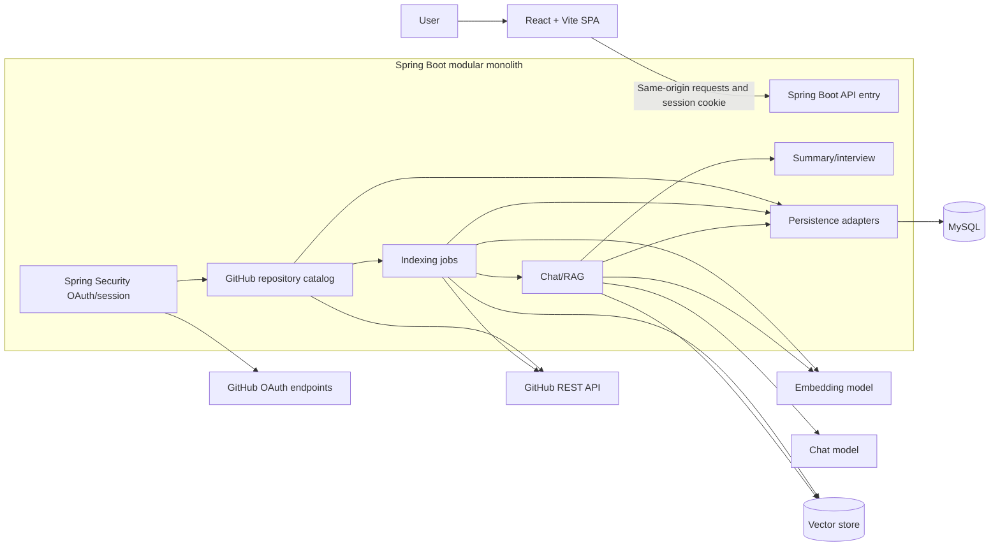
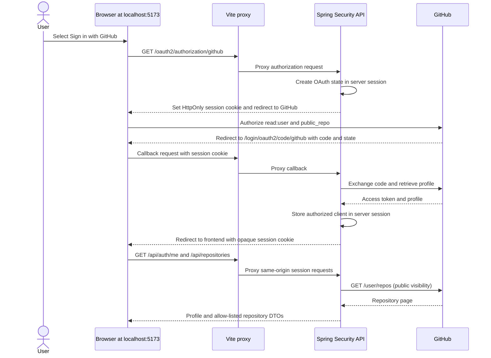

# Architecture

**Status:** Milestone 2 implements GitHub OAuth login, a server-side session, current-user status, and public repository listing. Indexing, vector storage, and model integration remain planned.

The implementation is a responsive React/Vite client and a Spring Boot modular monolith. The browser uses Vite's same-origin development proxy for API and OAuth routes. Spring Security keeps the GitHub authorized client in the server's HTTP session, identified by an opaque HttpOnly cookie. The API retrieves public repository metadata from GitHub using the session-held token. MySQL is configured, but user profiles and repository results are not persisted in this milestone. Indexing, vector storage, and model integration remain unimplemented.

## System shape

RepoMind uses one deployable Spring Boot modular monolith with internal feature modules. The React/Vite application is a separate frontend build served behind the same public origin. In local development, Vite proxies `/api`, `/oauth2`, and `/login/oauth2` to the API so OAuth redirects and session cookies remain on `localhost:5173` in the browser. The implemented API coordinates GitHub OAuth and public repository listing. MySQL, indexing, vector storage, and Spring AI are future integrations; MySQL will own planned durable application state and the vector store will hold derived data.

The diagram shows the target monolith shape; only the authentication and repository catalog paths are implemented so far.



## Backend package boundaries

Suggested root package: `com.repomind`.

```text
auth/          controllers, OAuth callbacks, identity/session services
repository/    repository and branch DTOs, catalog service, ownership checks
indexing/      job API, orchestration, GitHub file source, filters, chunker
chat/          conversation/message APIs, retrieval, prompt and citation handling
summary/       summary and interview use cases (may start inside chat module)
integration/   GitHub, Spring AI, vector-store adapters and typed client errors
persistence/   JPA entities/repositories and database migrations
config/        security, CORS/CSRF, AI/vector configuration, async limits
common/        error response, validation, correlation ID; avoid a dumping ground
```

Controllers translate HTTP to service calls and DTOs; services own use cases and authorization; repositories handle relational persistence; integration adapters isolate external APIs. Avoid controllers calling each other or exposing persistence entities as API contracts. Keep module dependencies directed toward domain/use-case code and ports.

## Implemented authentication and request security

The local callback is `http://localhost:5173/login/oauth2/code/github`, proxied by Vite to Spring Security's default `/login/oauth2/code/{registrationId}` callback. Spring Security generates and validates OAuth `state`, exchanges the authorization code using backend-only environment credentials, retrieves the GitHub profile, and retains the `OAuth2AuthorizedClient` in `HttpSessionOAuth2AuthorizedClientRepository`. This milestone does not persist a local user or credential row.



The API session cookie is `HttpOnly` and `SameSite=Lax`. `SESSION_COOKIE_SECURE=false` is for localhost HTTP; deployment over HTTPS must set it to `true`. Use a consistent hostname for frontend and callback. OAuth failure redirects use a fixed, non-sensitive code. The frontend never receives or stores the GitHub access token.

Because sessions use cookies, unsafe methods require Spring Security CSRF protection. `GET /api/auth/csrf` supplies a token to the SPA; the page keeps it in memory and sends it in the header for `POST /api/auth/logout`. Logout invalidates the session and expires its cookie. `GET /api/auth/me` is a public session check; protected API requests such as `/api/repositories` return `401` without a session. No broad CORS configuration is used; the local frontend proxies API/auth routes and deployed operation should use a same-origin reverse proxy. Derive identity from the Spring Security principal; never accept user ownership from request data.

This milestone uses a GitHub OAuth App with `read:user` and `public_repo`; repository listing filters to public visibility. GitHub's `public_repo` scope gives the OAuth token full access to public repositories, including hooks, even though RepoMind only performs reads. Private access is excluded. A GitHub App can provide read-only repository permissions and is a future option. Never place client secrets or access tokens in Vite variables, browser storage, URLs, or logs.

## Repository authorization

The current repository page is sourced from GitHub's authenticated `/user/repos` API and maps only the repository ID, full name, description, visibility, language, URL, and default branch. The API does not accept repository IDs from the browser or store repository rows yet. Future jobs, conversations, and retrieval requests must check current-user ownership and repository relationship. Repository identifiers in a vector filter are additional isolation, not a substitute for API authorization.

## Indexing pipeline

```mermaid
sequenceDiagram
  participant C as Controller
  participant S as Index service
  participant G as GitHub adapter
  participant P as File policy/chunker
  participant E as Embedding adapter
  participant V as Vector store
  participant D as MySQL repositories
  C->>S: requestIndex(repoId, branch)
  S->>G: verify access + resolve branch SHA
  S->>D: persist QUEUED job
  S-->>C: job ID
  S->>D: transition RUNNING
  S->>G: fetch tree and eligible file contents
  G-->>P: path, text, commit SHA
  P->>P: reject binaries/generated/secrets; chunk with line spans
  P->>E: chunk batch
  E->>V: upsert vectors + provenance
  S->>D: persist counts and terminal status
```

Resolve a branch to an immutable commit SHA at job start. Keep per-file and total-repository limits, timeouts, bounded worker concurrency, cancellation, and retry rules. Store enough metadata to identify an index snapshot. Writes should be idempotent by a deterministic key such as repository + commit SHA + path + chunk ordinal/content hash. Treat a failed new index as incomplete; activate it only after all required work succeeds. Exact cleanup/atomic swap depends on vector-store capabilities and is an implementation decision.

## File policy and provenance

Use an allow-list of text-like extensions plus explicit language detection where possible. Exclude common build output, dependency/vendor, generated, cache, and binary paths; impose file-size, content-size, and total-index limits. Exclude sensitive filenames and apply a secret-pattern scanner before embedding. Never assume filtering catches every credential. Preserve stable 1-based line start/end through normalization and chunking. Each vector carries `userId`, `repositoryId`, `branch`, `commitSha`, `path`, `lineStart`, `lineEnd`, `chunkId`, `language`, and `jobId` metadata; do not put access tokens in metadata.

## RAG and citation integrity

At question time: authorize local repository and conversation; choose the active indexed snapshot; embed the query; perform similarity search constrained by repository and snapshot; cap context; prompt with untrusted snippets as data; request citation chunk IDs; validate those IDs against retrieved results; map them to file path and line span. Persist the user and assistant messages, citations, and model/provider metadata suitable for audit without persisting secrets. If no evidence is relevant, answer with an explicit limitation. Never let the model invent a path or line number as a citation. The first version needs neither reranking nor model tool-calling.

Summary and interview generation reuse the retrieval service with task-specific prompts and budgets. Output format is validated before returning. A provider abstraction/configuration should allow changing the chat and embedding provider without changing domain services; vector dimensions must match the configured embedding model and require reindexing when they change.

## Data and resilience

The planned MySQL schema stores local users, linked GitHub identity/credential reference, repository metadata, index jobs, conversations, messages, and citation records (see [DATABASE.md](DATABASE.md)). This milestone only uses MySQL connectivity inherited from the foundation; it does not write these entities. Future vector records are rebuildable derived data. Use migrations, transactions for relational state transitions, timeouts and bounded retries for external calls, and a consistent error mapper. Do not hold a database transaction open during a long GitHub or model call. Use a bounded task executor initially; a message broker is not required for the first modular-monolith version.

## Deployment plan (proposed)

- Build static Vite assets and serve behind a TLS reverse proxy/CDN; route `/api`, `/oauth2`, and `/login/oauth2` to Spring Boot. Same-origin session cookie simplifies CSRF/CORS. The local Vite proxy covers those three route prefixes for development.
- Run one or more identical API instances only after session storage is shared (e.g. distributed Spring Session) or routing is sticky; initial deployment can use one API instance.
- Provision managed MySQL and a private vector service (Chroma or compatible) with persistent storage, network restrictions, backups, health checks, and access credentials in a secrets manager.
- Configure the GitHub OAuth callback URL, frontend redirect URL, secure-cookie flag, model provider/model IDs, database URL, vector endpoint, quotas, and timeouts through environment/secret management.
- Use health/readiness checks that distinguish application readiness from external provider health. Avoid returning secret/config values from diagnostics.
- Add structured logs with request/job correlation IDs, metrics for job durations/failures, provider latency/rate limits, and retrieval counts. Redact tokens and avoid raw repository source/prompt logging.
- Define retention, user data deletion, vector cleanup, database backup/restore, and incident procedures before production.

## Key decisions to validate

Spring AI provider and embedding dimensions, when to replace the current public-only OAuth App with a read-only GitHub App, durable/shared session storage, vector-store version and atomic replacement behavior, migrations tool, asynchronous worker limits, deployment provider, and data retention remain open.
