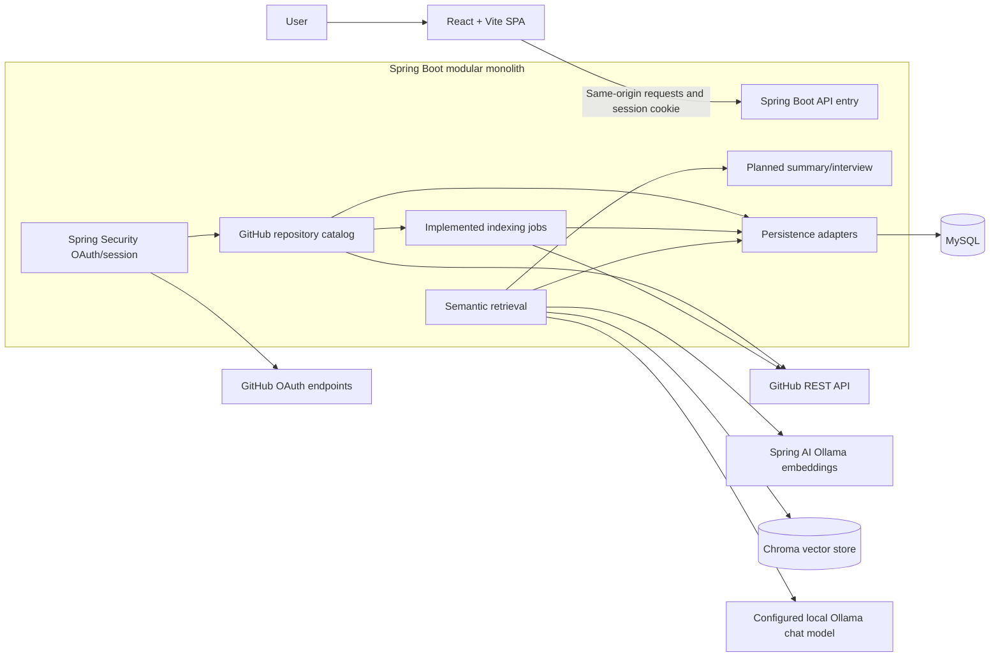
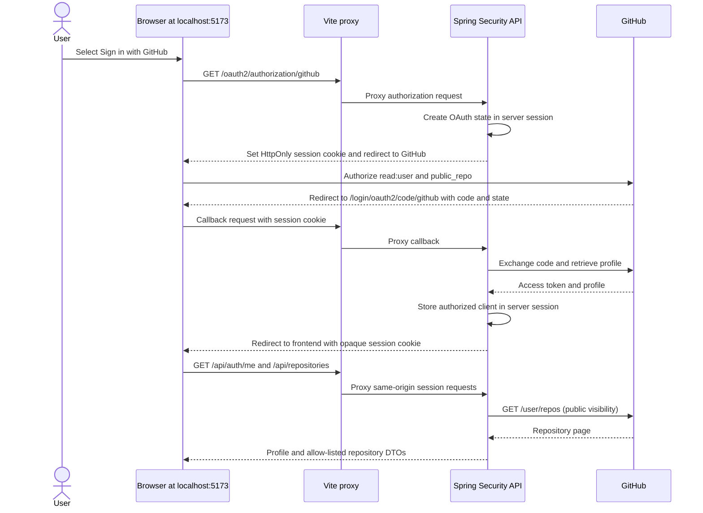

# Architecture

**Status:** Repository Q&A now implements grounded answer generation on top of GitHub OAuth, public repository and branch browsing, asynchronous indexing, MySQL chunks, Spring AI Ollama embeddings, and Chroma semantic retrieval. Summaries and interview generation remain planned. Q&A requires an explicitly configured local Ollama chat model.

The implementation is a responsive React/Vite client and a Spring Boot modular monolith. The browser uses Vite's same-origin development proxy for API and OAuth routes. Spring Security keeps the GitHub authorized client in the server's HTTP session, identified by an opaque HttpOnly cookie. Public repository metadata remains remote; MySQL persists indexing jobs, eligible source chunks, and each chunk's embedding progress through Flyway migrations. Chroma stores vectors and searchable provenance metadata. User profiles and GitHub tokens are not persisted in MySQL.

## System shape

RepoMind uses one deployable Spring Boot modular monolith with internal feature modules. The React/Vite application is a separate frontend build served behind the same public origin. In local development, Vite proxies `/api`, `/oauth2`, and `/login/oauth2` to the API so OAuth redirects and session cookies remain on `localhost:5173` in the browser. The implemented API coordinates GitHub OAuth, public repository/branch browsing, bounded indexing, embedding, and semantic retrieval. MySQL stores job, chunk, and embedding-state data; Chroma stores vector documents. Local semantic search requires Ollama and Chroma to be running.

The diagram shows implemented indexing, retrieval, and local-model Q&A.



## Backend package boundaries

Suggested root package: `com.repomind`.

```text
auth/          controllers, OAuth callbacks, identity/session services
repository/    repository and branch DTOs, catalog service, ownership checks
indexing/      job API, orchestration, GitHub file source, filters, chunker
chat/          conversation/message APIs, retrieval, prompt and citation handling
summary/       summary and interview use cases (may start inside chat module)
integration/   GitHub, Spring AI, vector-store adapters and typed client errors
persistence/   JPA entities/repositories and database migrations
config/        security, CORS/CSRF, AI/vector configuration, async limits
common/        error response, validation, correlation ID; avoid a dumping ground
```

Controllers translate HTTP to service calls and DTOs; services own use cases and authorization; repositories handle relational persistence; integration adapters isolate external APIs. Avoid controllers calling each other or exposing persistence entities as API contracts. Keep module dependencies directed toward domain/use-case code and ports.

## Implemented authentication and request security

The local callback is `http://localhost:5173/login/oauth2/code/github`, proxied by Vite to Spring Security's default `/login/oauth2/code/{registrationId}` callback. Spring Security generates and validates OAuth `state`, exchanges the authorization code using backend-only environment credentials, retrieves the GitHub profile, and retains the `OAuth2AuthorizedClient` in `HttpSessionOAuth2AuthorizedClientRepository`. This milestone does not persist a local user or credential row.



The API session cookie is `HttpOnly` and `SameSite=Lax`. `SESSION_COOKIE_SECURE=false` is for localhost HTTP; deployment over HTTPS must set it to `true`. Use a consistent hostname for frontend and callback. OAuth failure redirects use a fixed, non-sensitive code. The frontend never receives or stores the GitHub access token.

Because sessions use cookies, unsafe methods require Spring Security CSRF protection. `GET /api/auth/csrf` supplies a token to the SPA; the page keeps it in memory and sends it in the header for `POST /api/auth/logout`. Logout invalidates the session and expires its cookie. `GET /api/auth/me` is a public session check; protected API requests such as `/api/repositories` return `401` without a session. No broad CORS configuration is used; the local frontend proxies API/auth routes and deployed operation should use a same-origin reverse proxy. Derive identity from the Spring Security principal; never accept user ownership from request data.

This milestone uses a GitHub OAuth App with `read:user` and `public_repo`; browsing and indexing are limited to public repositories. GitHub's `public_repo` scope gives the OAuth token full access to public repositories, including hooks, while RepoMind only makes read requests for metadata and source content. Private access is excluded. A GitHub App can provide read-only repository permissions and is a future option. Never place client secrets or access tokens in Vite variables, browser storage, URLs, or logs.

## Repository authorization

Repository pages are sourced from GitHub's authenticated `/user/repos` API. Branch listing and index submission first scan that same user's public repository pages for the supplied numeric ID (bounded by configuration), then resolve repository metadata from GitHub by ID. The browser cannot supply an owner/name pair. Job reads include both job ID and authenticated GitHub user ID in the database query; a non-owner receives 404. Search selects the caller's latest completed job by repository ID and owner. Chroma searches filter by owner, repository, and commit, then the API checks those fields again; vector filters supplement, never replace, relational authorization.

## Indexing pipeline


sequenceDiagram
  participant C as Controller
  participant S as Index service
  participant G as GitHub adapter
  participant P as File policy/chunker
  participant D as MySQL
  C->>S: requestIndex(repoId, branch)
  S->>G: verify selected ID is visible; resolve branch SHA
  S->>D: persist QUEUED job
  S-->>C: job ID
  S->>D: transition RUNNING
  S->>G: fetch tree and eligible file contents
  G-->>P: Git tree entries and blob bytes
  P->>P: reject binaries/generated/secrets; chunk with line spans
  P->>D: atomically persist chunks and SUCCEEDED status
```

The API resolves the selected branch to an immutable commit SHA before storing a `QUEUED` job. The bounded worker obtains a recursive tree, rejects truncated or over-limit trees, and retrieves eligible Git blobs. The path/content policy excludes binary, symlink, submodule, generated, oversized, and likely secret-bearing files. Each text file is divided into bounded overlapping chunks with 1-based line numbers. A successful job and its chunk rows are committed together; a failed job stores a safe code and no partial chunk rows. Chunk metadata includes repository ID, authenticated GitHub user ID, branch, commit SHA, file path, blob SHA, chunk number, line span, and a content hash. Chunk text is private application data; status APIs do not return it.

Workers have bounded thread and queue capacities. GitHub calls have connect/read timeouts; jobs have a processing deadline and configured tree/file/content limits. GitHub rate-limit and upstream failures map to safe job codes. An application restart marks `QUEUED`/`RUNNING` jobs `FAILED` with `SERVER_RESTARTED`; work is not resumed. Retry is a new job. The initial single-instance design uses in-process admission synchronization; it does not claim distributed scheduling or multi-instance quotas.

## File policy and provenance

The implemented filter uses known binary extensions, UTF-8/NUL checks, generated/vendor/build directory names, sensitive filename patterns, and credential/private-key patterns. It is heuristic and can miss credentials; filtered source is persisted in MySQL, so access and retention controls matter. Chunks preserve 1-based line ranges through newline normalization. The MySQL rows carry repository ID, authenticated GitHub user ID, branch, commit SHA, path, blob SHA, chunk index, line range, and content hash. No access token is persisted. Future vector records should also carry scoped snapshot metadata.

## RAG and citation integrity

**Implemented retrieval:** `POST /api/repositories/{repositoryId}/search` finds the caller's latest completed index snapshot, embeds pending or outdated-format MySQL chunks in batches, and writes deterministic chunk IDs plus owner, repository, branch, commit, path, line, blob, and content-hash metadata to Chroma. Embedding text adds the file path, language, and detected Java declarations to the source chunk so file/class terminology is represented in the vector. V2 records each chunk's `PENDING`/`INDEXED` state in MySQL. A context-format marker in `embedding_model` triggers a safe re-embedding of existing chunks; stable IDs make Chroma writes idempotent. The question is embedded with the same Ollama model; vector search is filtered by owner/repository/commit and oversamples candidates. The service merges a bounded lexical query from MySQL scoped to the same job, owner, repository, and commit, then ranks candidates using vector similarity, source-term coverage, and filename/path matches. Result IDs are reloaded and verified through the owned MySQL job, and source text/path/lines come from MySQL instead of Chroma.

**Implemented answer generation:** `POST /api/repositories/{repositoryId}/ask` calls the same semantic/hybrid retrieval service and uses only its owner-scoped latest-snapshot results. The question plus at most 12,000 characters of retrieved chunks are sent to a configured local Ollama chat model; no paid provider is used. Retrieved repository text is untrusted input and the system prompt explicitly tells the model not to follow instructions inside it. The model returns answer text plus application-issued source IDs. The service discards unknown IDs and fills citations from retrieved result metadata, so the model cannot supply arbitrary paths or line numbers. Empty retrieval or invalid/empty citations return an explicit insufficient-evidence response. Model output can still be wrong; citations show the evidence provided and do not guarantee correctness.

`REPOMIND_CHAT_MODEL` is optional at startup and has no default to avoid silently selecting a model. Set it to a chat-capable tag installed in local Ollama. Startup requires both `OLLAMA_BASE_URL` and `CHROMA_HOST` to use loopback endpoints: Ollama receives source text for embeddings and answers, while Chroma stores source text with vectors. Remote endpoints are rejected before repository content can be sent. If configuration is missing or Ollama cannot serve the model, `/ask` returns a safe 503 (`LOCAL_CHAT_MODEL_NOT_CONFIGURED` or `LOCAL_CHAT_MODEL_UNAVAILABLE`). Model calls do not log source snippets or prompts. The initial answer endpoint is stateless and does not persist conversations.

`GET /api/repositories/{repositoryId}/index-status` restores index state after a page reload. It returns the authenticated user's newest job attempt separately from their newest successful snapshot, so a failed re-index can be shown without hiding a previously usable snapshot. Repository cards are keyed by GitHub repository ID; answer and search state stay scoped to the card and are discarded when that repository leaves the rendered page.

Summary and interview generation reuse the retrieval service with task-specific prompts and budgets. Output format is validated before returning. A provider abstraction/configuration should allow changing the chat and embedding provider without changing domain services; vector dimensions must match the configured embedding model and require reindexing when they change.

## Data and resilience

Flyway applies versioned MySQL migrations; Hibernate schema generation remains disabled. V1 creates `index_jobs` and `code_chunks`; V2 adds embedding status/model columns and a pending-work index. GitHub calls run outside database transactions; job state and chunks are persisted transactionally. Embeddings live in Chroma and MySQL tracks chunk processing state. User profiles/repository rows are not stored, and OAuth authorized clients remain in the server session. Use bounded embedding batches and the common safe error mapper. A message broker is not needed for this single-instance foundation.

## Deployment plan (proposed)

- Build static Vite assets and serve behind a TLS reverse proxy/CDN; route `/api`, `/oauth2`, and `/login/oauth2` to Spring Boot. Same-origin session cookie simplifies CSRF/CORS. The local Vite proxy covers those three route prefixes for development.
- Run one or more identical API instances only after session storage is shared (e.g. distributed Spring Session) or routing is sticky; initial deployment can use one API instance.
- Provision managed MySQL and a private vector service (Chroma or compatible) with persistent storage, network restrictions, backups, health checks, and access credentials in a secrets manager.
- Configure the GitHub OAuth callback URL, frontend redirect URL, secure-cookie flag, model provider/model IDs, database URL, vector endpoint, quotas, and timeouts through environment/secret management.
- Use health/readiness checks that distinguish application readiness from external provider health. Avoid returning secret/config values from diagnostics.
- Add structured logs with request/job correlation IDs, metrics for job durations/failures, provider latency/rate limits, and retrieval counts. Redact tokens and avoid raw repository source/prompt logging.
- Define retention, user data deletion, vector cleanup, database backup/restore, and incident procedures before production.

## Key decisions to validate

Pinning Ollama model and Chroma image versions beyond local defaults, replacing the current public-only OAuth App with a read-only GitHub App, durable/shared session storage, vector snapshot cleanup, deployment provider, and source-chunk retention remain open.
