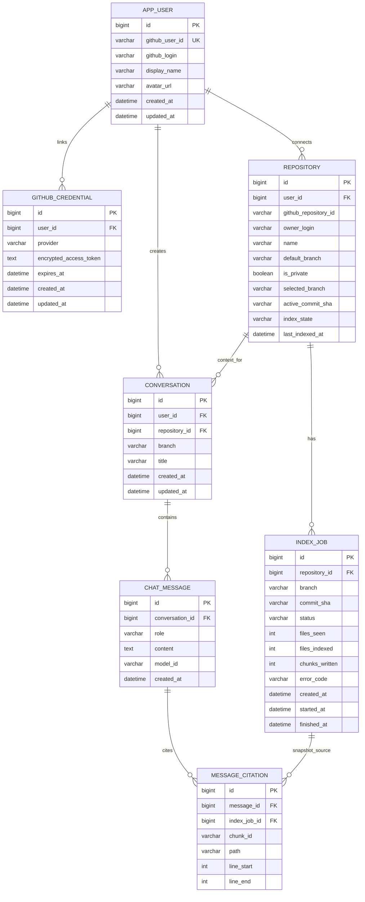

# Database Design

**Status:** Logical schema proposal; physical types, migrations, and indexes will be finalized with the first persistence milestone.

MySQL is the source of truth for users and application workflows. Embeddings and chunk metadata live in the vector store; relational records retain job and snapshot state so the vector collection can be scoped and rebuilt.

## Entity relationship diagram

## Table intent and constraints

- **APP_USER:** Local identity keyed by an internal numeric ID. `github_user_id` is the stable external identity and must be unique; login can change.
- **GITHUB_CREDENTIAL:** Optional server-side authorization needed to call GitHub later. Encrypt token material using an application/KMS-managed key, never log it, and support revocation/deletion. Whether this is a separate credential table or delegated identity store depends on the selected Spring Security flow. Do not store plaintext tokens.
- **REPOSITORY:** A repository connection/access record associated with a local user. Unique key should include `(user_id, github_repository_id)` so multiple users can connect the same GitHub repository independently. Store GitHub numeric/node ID as a string if provider ID format may change. Ownership here means “connected by user,” not ownership of the GitHub repository.
- **INDEX_JOB:** Immutable indexing attempt for a repository/branch/commit. Status values: `QUEUED`, `RUNNING`, `SUCCEEDED`, `FAILED`, `CANCELLED`. An explicit retry creates a new row linked to the same repository rather than resetting a terminal attempt. Keep safe error code and counts; detailed exception belongs in protected logs. Enforce one active job per repository/branch with application-level coordination or a suitable database strategy.
- **CONVERSATION:** Owned by a local user and bound to a connected repository and branch/snapshot context. Validate `user_id` matches the repository owner at creation and every access.
- **CHAT_MESSAGE:** Ordered messages in a conversation. Role values are restricted to `USER` and `ASSISTANT` (system instructions are application-managed and should not be represented as user-authored rows). Add deterministic ordering by `(conversation_id, created_at, id)`.
- **MESSAGE_CITATION:** Citation evidence associated with an assistant message. Store the chunk ID and provenance snapshot reference; citations are resolved from trusted retrieved data, not invented from raw model output.

## Referential integrity and authorization

Use foreign keys and indexes on all foreign keys. Query conversations using both `conversation_id` and authenticated `user_id`; query repositories and jobs through the same owner relationship. A possession of an integer or UUID identifier is not authorization. Use non-sequential public IDs if enumeration risk warrants it, but keep ownership checks regardless. Cascade delete user-owned conversations, messages, repositories, and jobs only after the product's retention behavior is defined; token revocation and vector cleanup require explicit service operations.

## Suggested indexes

- `APP_USER(github_user_id)` unique.
- `GITHUB_CREDENTIAL(user_id, provider)` unique (if one credential per provider/user).
- `REPOSITORY(user_id, github_repository_id)` unique; `REPOSITORY(user_id, index_state)`.
- `INDEX_JOB(repository_id, created_at)`; `INDEX_JOB(status, created_at)` for worker polling.
- `CONVERSATION(user_id, updated_at)`; `CONVERSATION(repository_id, branch)`.
- `CHAT_MESSAGE(conversation_id, created_at, id)`.
- `MESSAGE_CITATION(message_id)` and `MESSAGE_CITATION(index_job_id)`.

## Vector record metadata

The vector store receives embedding plus a stable chunk ID and metadata including `userId`, `repositoryId`, `branch`, `commitSha`, `indexJobId`, `path`, `lineStart`, `lineEnd`, `language`, and a content hash. Retrieval filters must include repository/snapshot scope. The backend first authorizes the user in MySQL, then applies vector filters; a vector filter alone is never an access-control boundary. Define retention and delete-by-filter behavior before enabling repository removal or user deletion.

## Migration and lifecycle notes

Use a versioned migration tool (choice TBD) from the first persistence milestone; do not rely on automatic production schema generation. Store UTC timestamps. Keep remote calls outside relational transactions. Persist a job before asynchronous work begins, then update state/counts transactionally. Index records are tied to commit SHA so branch movement creates a new snapshot rather than silently mutating history. Retention, token encryption mechanism, and public-ID strategy remain open choices.
