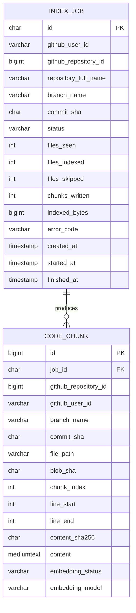

# Database Design

**Status:** Milestone 3B uses MySQL for indexing jobs, source-code chunks, and per-chunk embedding progress. Flyway applies versioned migrations at startup; Hibernate `ddl-auto` is `none`. GitHub profiles, repository catalogs, OAuth clients/tokens, conversations, and embedding vectors are not stored in MySQL; vectors and retrieval metadata are stored in Chroma.

## Implemented entity relationship

The physical schema is created by V1 (`index_jobs` and `code_chunks`) and V2 (`embedding_status`, `embedding_model`, and the pending-embedding index) under `backend/src/main/resources/db/migration/`. `index_jobs.id` is a UUID string. GitHub user and repository IDs are copied from the authenticated identity and verified GitHub response; there is no local user/repository FK in this milestone. `code_chunks.job_id` references the job with cascade delete. Job lookup always uses both job ID and GitHub user ID, so knowing another user's job UUID is not sufficient to read it.

## Job and chunk lifecycle

- A job pins the selected branch to a commit SHA before it is queued. Status values are `QUEUED`, `RUNNING`, `SUCCEEDED`, and `FAILED`.
- Files are filtered and chunked in bounded asynchronous work. Source text is persisted in `code_chunks.content`, with repository, user, branch, commit, path, blob SHA, chunk index, line range, and SHA-256 metadata.
- Chunks and `SUCCEEDED` status are written in one relational transaction after all eligible work succeeds. A failure records a safe error code and counters; it does not persist partial chunks. Job APIs return counts and status only, never chunk content.
- Startup recovery marks prior `QUEUED` and `RUNNING` jobs `FAILED` with `SERVER_RESTARTED`. The worker is not resumed automatically; retry creates a new job.
- `embedding_status` starts as `PENDING`; successful vector writes change it to `INDEXED` and record the configured model plus embedding-context version in `embedding_model`. A changed model or context version re-embeds old chunks. If a provider call fails, completed batches remain indexed and unprocessed rows stay pending. A retry uses the same SHA-256-derived vector ID from owner, repository, branch, commit, path, chunk/line range, and content hash; Chroma upserts that ID and metadata also includes the relational `code_chunks.id`.
- Chroma documents store the vector and metadata fields for chunk ID, owner, repository, branch, commit, path, line range, blob SHA, and content hash. Their embedding input includes source text, file path, language, and detected Java declarations. Search first selects an owned completed job from MySQL, filters Chroma by owner/repository/commit, and adds bounded lexical candidates from MySQL with the same owner/repository/commit scope. Candidate metadata and the selected job are checked before returning snippets. Vector filters alone are not authorization.
- GitHub calls happen outside database transactions. Index job state changes use short transactions. No access token is stored in either table.

## Indexes and ownership

The migration adds `(github_user_id, created_at)` and `status` indexes to `index_jobs`, and an index on `code_chunks.job_id`. Ownership is enforced by querying `(id, github_user_id)` at the service boundary; job IDs are not treated as authorization. MySQL stores source code, which may still contain secrets that evade heuristic filtering. Protect the database, restrict operational access, and define retention/deletion policy before deployment beyond local development.

## Configured resource limits

Default per-job limits are 500 eligible files, 256 KiB per file, 10 MiB total eligible source bytes, 100,000 Git tree entries, 10-minute processing time, 1–2 worker threads, and a queue of four jobs. Configuration is supplied through `INDEX_*` environment variables and validated/capped by the application. These limits bound typical memory and provider use, but this initial in-process executor is intended for a single API instance.

## Planned future schema

Later milestones may add local users, repository connections, conversations, messages, and citations. Those tables are deliberately absent today: the app currently uses the GitHub numeric user ID as the job owner and stores repository identity as metadata. If a local `APP_USER` table is introduced, migrate ownership with explicit foreign keys and keep GitHub authorization tokens in Spring Security's server-side authorized-client storage or another encrypted credential service. Do not add plaintext token columns.

Vectors remain in a separate Chroma service; they are not duplicated into MySQL. Chunk status is MySQL bookkeeping, not proof that Chroma is available or fully backed up. Chroma persistence, model changes, and vector cleanup must be covered by operations and retention procedures. MySQL authorization must happen before vector retrieval; vector filters alone are not an authorization boundary.
