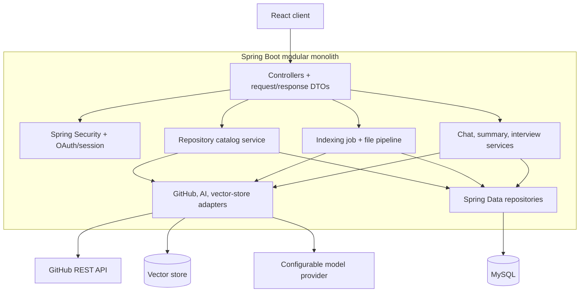
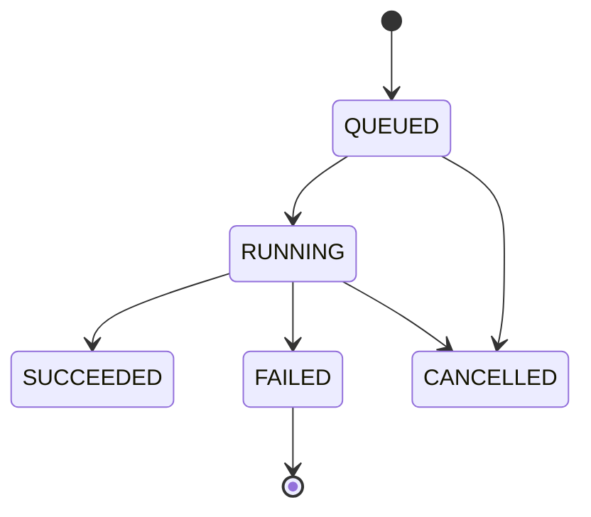

# RepoMind Project Specification

**Status:** Milestone 3B implements the React/Vite dashboard, Spring Boot modular monolith, GitHub OAuth session, public repository/branch listing, asynchronous indexing, MySQL chunks, Spring AI Ollama embeddings, and Chroma semantic retrieval. Chat generation, summaries, and interview generation remain planned.

## 1. Problem statement

Developers joining an unfamiliar project spend time locating relevant code, tracing relationships between files, and forming a reliable mental model of the system. RepoMind will let a user connect a GitHub identity, select an accessible repository and branch, index eligible code, and ask natural-language questions answered with verifiable file and line references. It will also generate repository summaries and interview questions with suggested, repository-grounded answers.

## 2. Goals and boundaries

### Goals

- Authenticate users through GitHub and list only repositories GitHub authorizes them to see. **Milestone 2 scope:** public repositories only.
- Allow repository and branch selection and provide durable indexing status. **Milestone 3A:** implemented for public repositories.
- Fetch, filter, and chunk source files with provenance metadata. **Milestone 3A:** persisted in MySQL.
- Retrieve relevant code for natural-language questions using owner/repository/commit scoped semantic search, returning file paths, line ranges, scores, snippets, and commit SHA. **Milestone 3B:** implemented; no chat answer generation yet.
- Generate a repository overview and project-specific interview practice.
- Store user profiles, repository records, indexing jobs, and chat history in MySQL.
- Handle invalid input, authorization failures, GitHub/API limits, indexing errors, and unavailable embedding/vector services with useful, non-sensitive errors.

### Non-goals for the first version

- Writing, committing, or modifying source code in GitHub repositories.
- Organization-wide administration or background synchronization of every repository.
- Training or fine-tuning a model on repository content.
- Multi-service deployment; the backend remains a modular monolith.
- Guarantees that generated answers are correct; citations make evidence inspectable.

## 3. User stories

1. As a developer, I sign in with GitHub and see repositories available to my identity.
2. I choose a repository and branch, start indexing, and can see progress or a useful failure state.
3. I ask a question and receive an answer with file paths and line ranges that I can inspect.
4. I request a repository summary or interview questions with suggested answers and sources.
5. I can return to my own conversations, while another user cannot read them or use their repository records.

## 4. Functional requirements and acceptance intent

| ID | Requirement | Acceptance intent |
|---|---|---|
| FR-01 | GitHub sign-in | **Implemented in Milestone 2:** Spring Security validates OAuth state, returns the GitHub profile through `/api/auth/me`, and retains the authorized client in a server-side session. Local user persistence remains planned. |
| FR-02 | Repository listing and branch selection | **Implemented in Milestone 3A:** authenticated, paginated public repository and branch listing. Repository metadata is not stored separately. |
| FR-03 | Indexing jobs | **Foundation implemented in Milestone 3A:** jobs pin repository, branch and commit, track status/timestamps/counts, and expose safe failure codes. |
| FR-04 | File policy | **Implemented in Milestone 3A:** binary, symlink, submodule, generated, oversized, and heuristic likely-secret files are excluded. The scanner is not a guarantee of secret detection. |
| FR-05 | Provenance | **Implemented in Milestone 3A:** MySQL chunks keep repository/user, branch, commit, file path, blob SHA, chunk index, content hash, and 1-based line range. |
| FR-06 | Semantic code search | **Implemented in Milestone 3B:** retrieval is scoped to the authenticated owner's latest completed repository snapshot and returns source snippets with path, line, score, and commit metadata. Chat answer generation remains planned. |
| FR-07 | Summary and interview practice | Planned: these use retrieved repository evidence and return citations where appropriate. |
| FR-08 | History | Planned: conversations and messages are persisted and owner-checked. |
| FR-09 | Resilience | Implemented for GitHub, validation, queue/limit failures, indexing status, and safe embedding/vector-service failures. |

## 5. Quality and security requirements

- Modular monolith with controller, DTO, service, repository, and configuration boundaries.
- Validate request bodies, identifiers, branch names, file sizes, and paging limits.
- Never expose OAuth tokens, provider keys, raw exception details, or secret-like file contents in responses/logs.
- Authorize repository, job, and conversation reads and mutations using the authenticated owner, not a client-supplied user ID.
- Use least-privilege GitHub scopes and only request repository content access when required. Evaluate a GitHub App if finer-grained access is preferred.
- Use CSRF protection for cookie-authenticated state-changing requests, secure cookie attributes, strict CORS, and rate limiting at a suitable layer.
- Avoid logging prompts or repository source by default; define retention and deletion behavior before production.
- Ensure answer citations are derived from retrieval records; treat repository content as untrusted prompt input.
- Add unit and integration tests in later implementation milestones; documentation alone does not establish these properties.

The OAuth App requests `read:user` and `public_repo`. The latter permits full access to public repositories, including hooks, while RepoMind only reads repository metadata, branches, and source blobs. Private repository access is not requested. GitHub Apps provide finer-grained read-only permissions and remain a future consideration.

## 6. Planned architecture

### Module responsibilities

- **security/auth:** OAuth initiation/callback, local user mapping, session lifecycle, current-user access.
- **repository:** GitHub repository/branch listing and local repository metadata.
- **indexing:** job orchestration, file policy, chunking, embedding, vector writes/deletes, retries and status.
- **chat:** conversation ownership, retrieval, prompt assembly, grounded answer generation, summary/interview use cases.
- **persistence:** relational mappings and migrations for application records.
- **integrations:** GitHub client, Spring AI model/embedding adapters, vector-store adapter, configuration and health checks.

## 7. Indexing workflow

1. Authenticate the user and verify that the repository is returned by GitHub for that user's authorization.
2. Validate the selected branch; resolve it to a commit SHA so one job indexes an immutable snapshot.
3. Create a `QUEUED` job. A bounded asynchronous worker transitions through `RUNNING` to `SUCCEEDED` or `FAILED`; persist counts and safe error codes.
4. Retrieve a bounded recursive tree or paginated content listing and fetch only supported text files. Respect GitHub rate limits and cancellation where feasible.
5. Apply allow/deny rules: reject binary encodings, known generated/vendor/build directories, oversized files, and likely secrets (credential patterns and sensitive filenames). Rules should be configurable and reviewed; filtering reduces exposure but cannot guarantee detection.
6. Normalize line endings without losing line mapping; split source into token/character-bounded overlapping chunks and preserve 1-based line ranges.
7. **Milestone 3B:** on the first semantic-search request, embed pending chunks from the latest completed snapshot in bounded batches using Spring AI's Ollama integration and upsert Chroma documents with deterministic IDs and provenance metadata.
8. Embed the question with the same model; search only the authenticated owner's repository and commit, verify returned metadata again, and return bounded snippets with path/line/score references. Provider failures leave completed batches reusable and remaining rows pending. Chat generation is a later milestone.

## 8. Semantic retrieval and future RAG workflow

Implemented retrieval first resolves an owned completed job in MySQL, embeds pending source chunks, and retrieves a bounded result set filtered by owner, repository, and commit. The API validates vector metadata again and returns source-derived paths, line ranges, and commit information. It does not generate a chat answer. A future prompt must answer only from supplied evidence, state when evidence is insufficient, and cite retrieved chunk IDs. Chat history should be bounded and treated as context, not as authority. Repository text is untrusted input and must not override system instructions or trigger tools. The initial chat version does not require reranking or model tool-calling.

## 9. Failure behavior

- Invalid JSON, missing values, invalid branch/repository selection: `400` with field-level details.
- Unauthenticated request: `401`; authenticated user lacks ownership/access: `403` or deliberately non-disclosing `404`.
- GitHub rate limit/unavailable: stable integration error; indexing job records retryable/non-retryable safe code.
- AI/vector unavailable: `503` for synchronous request or `FAILED` job state; do not fabricate an answer or mark an index complete.
- Empty retrieval: return a clear insufficient-context answer with no unsupported citations.
- Internal failures: correlation ID and generic response; protected logs hold diagnostic context without credentials/source content.

## 10. Open decisions

- Whether to migrate from the implemented OAuth App to a GitHub App for finer-grained, read-only repository permissions before enabling broader repository operations or private repository access.
- Whether to retain GitHub tokens after login and how to encrypt/refresh/revoke them. Needed for private-repository indexing; do not persist plaintext.
- Chat model/provider, embedding dimension migration strategy, and any future hosted-provider costs. Milestone 3B uses Spring AI 1.1.8, local Ollama `nomic-embed-text`, and Chroma.
- Production vector-store deployment and isolation strategy. Local Chroma is configured for development.
- Indexing queue/executor strategy, job concurrency, retry limits, and maximum repository/file/chunk quotas.
- Vector data retention/deletion, conversation retention, and account deletion behavior.
- Deployment host, TLS/reverse proxy, secrets manager, backups, monitoring, and public demo constraints.

## 11. Delivery plan

1. Documentation and architecture review (complete).
2. Local project foundation, environment-based database configuration, health endpoint, and starter verification (complete).
3. GitHub OAuth/session, authenticated identity, and public repository listing (implemented; end-to-end OAuth configuration remains a local verification step).
4. Repository persistence, branch listing/selection, and ownership checks.
5. Index job model and secure source retrieval/filtering/chunk metadata.
6. Embeddings/vector adapter and indexing lifecycle tests.
7. Scoped RAG endpoints, citation validation, chat history, and failure handling.
8. Summary/interview use cases.
9. React client, accessibility/error states, and API integration.
10. Deployment configuration, operational documentation, end-to-end verification, and interview walkthrough.
